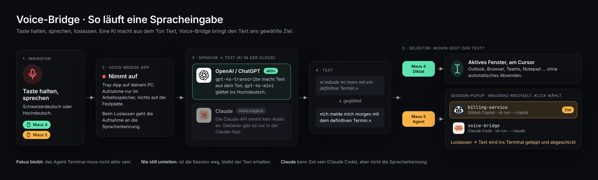
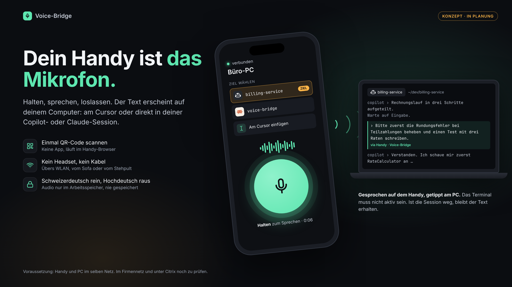

# Voice-Bridge

[](https://github.com/stefaneicher/voice-bridge/actions/workflows/ci.yml)
[](https://github.com/stefaneicher/voice-bridge/actions/workflows/codeql.yml)
[](https://github.com/stefaneicher/voice-bridge/releases/latest)
[](https://github.com/stefaneicher/voice-bridge/releases/latest)
[](https://github.com/stefaneicher/voice-bridge/releases/latest)
[](https://stefaneicher.github.io/voice-bridge/)
[](https://www.conventionalcommits.org/)

Systemweite Push-to-Talk-Spracheingabe für Windows. Schweizerdeutsch rein, Hochdeutsch raus.

**Webseite:** https://stefaneicher.github.io/voice-bridge/



Die Spracherkennung läuft über OpenAI. Claude bietet keine Sprach-API an, kann aber Ziel sein (`vb run -- claude`).



*Das Handy als Mikrofon: mit der Voice-Bridge-App für Android (siehe [Handy als Mikrofon](#handy-als-mikrofon-android)).*

## Installation

Voraussetzung: [Node.js 22](https://nodejs.org/) oder neuer.

**Aus dem GitHub-Release (empfohlen, keine Anmeldung nötig):**

<!-- x-release-please-start-version -->

Direkt aus dem Release [v0.1.0](https://github.com/stefaneicher/voice-bridge/releases/tag/v0.1.0) installieren:

```bash
npm install -g https://github.com/stefaneicher/voice-bridge/releases/download/v0.1.0/stefaneicher-voice-bridge-0.1.0.tgz
```

Oder die Datei [`stefaneicher-voice-bridge-0.1.0.tgz`](https://github.com/stefaneicher/voice-bridge/releases/download/v0.1.0/stefaneicher-voice-bridge-0.1.0.tgz) herunterladen und lokal installieren:

```powershell
npm install -g "$env:USERPROFILE\Downloads\stefaneicher-voice-bridge-0.1.0.tgz"
```

<!-- x-release-please-end -->

**Aus GitHub Packages** (braucht einmalig einen GitHub-Token mit `read:packages`):

```bash
npm config set @stefaneicher:registry https://npm.pkg.github.com
npm config set //npm.pkg.github.com/:_authToken <TOKEN>
npm install -g @stefaneicher/voice-bridge
```

Danach gibt es zwei Befehle: `voice-bridge` (die App) und `vb` (verbindet Agents).

<!-- x-release-please-start-version -->

**Ohne npm:** Im Release liegen auch [`Voice-Bridge-0.1.0-setup.exe`](https://github.com/stefaneicher/voice-bridge/releases/download/v0.1.0/Voice-Bridge-0.1.0-setup.exe) und die portable [`Voice-Bridge-0.1.0-portable.exe`](https://github.com/stefaneicher/voice-bridge/releases/download/v0.1.0/Voice-Bridge-0.1.0-portable.exe). Für `vb run` braucht es trotzdem das npm-Paket.

<!-- x-release-please-end -->

Hinter einem Firmen-Proxy lädt npm Electron von GitHub. Falls das blockiert ist: `ELECTRON_MIRROR` auf einen internen Spiegel setzen.

## Benutzung

1. Starten: `voice-bridge` (oder `voice-bridge --background`). Im Tray erscheint ein Mikrofon.
2. Im Tray-Menü **Einstellungen → Spracherkennung** den OpenAI-API-Key eintragen. Unter **Allgemein** lässt sich «Beim Anmelden starten» einschalten.

**Diktat:** Maus 4 halten, sprechen, loslassen. Der Text erscheint am Cursor, ohne automatisches Absenden.

**Agent:** Maus 5 halten und sprechen. Beim Zeiger erscheint ein Popup mit den laufenden Agent-Sessions. Mit dem Mausrad oder per Klick die Session wählen. Beim Loslassen geht der Prompt an die markierte Session, ohne Fokuswechsel.

Damit eine Session in der Liste erscheint, den Agent über Voice-Bridge starten:

```bash
vb run -- copilot
```

Beide Tasten sind in den Einstellungen frei belegbar (auch Tastaturtasten). Für Citrix ein eigenes Profil nutzen: `voice-bridge --profile citrix` und `vb run --profile citrix -- copilot`.

Geht etwas schief (Session beendet, Transkription fehlgeschlagen), bleibt der Text bzw. die Aufnahme erhalten, bis du entscheidest: erneut versuchen, andere Session wählen, kopieren oder verwerfen.

## Handy als Mikrofon (Android)

1. Im Release die Datei `voice-bridge-android-<version>.apk` aufs Handy laden und installieren (Installation aus unbekannten Quellen erlauben).
2. Auf dem PC in Voice-Bridge unter **Einstellungen → Handy** «Verbindungen vom Handy erlauben» einschalten, speichern und «QR-Code anzeigen» wählen. Windows fragt einmal nach der Firewall: «Zulassen».
3. In der App «QR-Code scannen». Handy und PC müssen im selben WLAN sein.
4. Ziel wählen («Am Cursor einfügen» oder eine Session), Knopf halten, sprechen, loslassen.

Die Verbindung ist verschlüsselt: Die App vertraut nur dem Zertifikat des gekoppelten PCs (Fingerabdruck im QR-Code). Im Firmennetz und unter Citrix blockiert die Firewall die Verbindung möglicherweise.

## Mockups

Alle Mockups im Browser: [Übersicht](https://raw.githack.com/stefaneicher/voice-bridge/main/docs/mockups/index.html)

| Mockup | Inhalt |
|---|---|
| [1a](https://raw.githack.com/stefaneicher/voice-bridge/main/docs/mockups/1a-diktat-aufnahme.html) | Diktat: Aufnahme läuft |
| [1b](https://raw.githack.com/stefaneicher/voice-bridge/main/docs/mockups/1b-diktat-eingefuegt.html) | Diktat: Text eingefügt |
| [2a](https://raw.githack.com/stefaneicher/voice-bridge/main/docs/mockups/2a-agent-session-popup.html) | Agent: Session-Popup |
| [2b](https://raw.githack.com/stefaneicher/voice-bridge/main/docs/mockups/2b-agent-gesendet.html) | Agent: Prompt gesendet |
| [3a](https://raw.githack.com/stefaneicher/voice-bridge/main/docs/mockups/3a-fehlerfaelle.html) | Fehlerfälle |
| [3b](https://raw.githack.com/stefaneicher/voice-bridge/main/docs/mockups/3b-tray-menue.html) | Tray-Menü |
| [3c](https://raw.githack.com/stefaneicher/voice-bridge/main/docs/mockups/3c-einstellungen.html) | Einstellungen |
| [4](https://raw.githack.com/stefaneicher/voice-bridge/main/docs/mockups/4-ablauf.html) | Ablauf: Mikrofon → KI → Ziel |
| [5](https://raw.githack.com/stefaneicher/voice-bridge/main/docs/mockups/5-handy-mikrofon.html) | Android-App: Handy als Mikrofon |

## Lokal testen (ohne Release)

```bash
git clone https://github.com/stefaneicher/voice-bridge.git
cd voice-bridge
npm install
npm run build
npm link        # stellt die Befehle voice-bridge und vb global bereit
voice-bridge    # App starten (Tray-Icon erscheint)
```

In einem zweiten Terminal: `vb run -- copilot`. Rückgängig machen mit `npm unlink -g @stefaneicher/voice-bridge`.

## Entwicklung und Release

```bash
npm run dev             # App mit Hot Reload
npm test                # Tests
npm run test:coverage   # Tests mit Abdeckungs-Gate (src/core ≥ 90 %)
npm run test:e2e        # App-Starttest (vorher npm run build)
npm run lint            # ESLint + Prettier
npm run knip            # ungenutzter Code und Abhängigkeiten
```

Commits folgen [Conventional Commits](https://www.conventionalcommits.org/), z. B. `feat: Mikrofon-Auswahl` oder `fix: Popup-Position bei zwei Monitoren`. Ein Git-Hook formatiert geänderte Dateien und prüft die Commit-Nachricht.

**Release:** release-please hält auf `main` einen Release-PR mit neuer Version und Changelog aktuell. Wird er gemergt, entstehen Tag und GitHub-Release, und GitHub Actions baut npm-Paket, Windows-Installer und portable `.exe` (npmjs.com nur mit Secret `NPM_TOKEN`).

### Quality Gates

| Gate | Wo |
|---|---|
| ESLint (inkl. Schichtregel für `src/core`), Prettier | Pre-Commit-Hook, CI |
| Conventional Commits (commitlint) | Commit-Hook, CI bei Pull Requests |
| Typprüfung (`tsc`, `svelte-check`) | CI auf Windows, Linux, macOS |
| Tests mit Abdeckung `src/core` ≥ 90 % | CI auf Windows, Linux, macOS |
| App-Starttest (Electron, Playwright) | CI |
| npm-Paket bauen, installieren, starten | CI |
| knip, actionlint | CI |
| CodeQL | CI und wöchentlich |
| Dependabot (npm, GitHub Actions) | wöchentlich |
| `npm audit` (Laufzeit-Abhängigkeiten) | Release |
